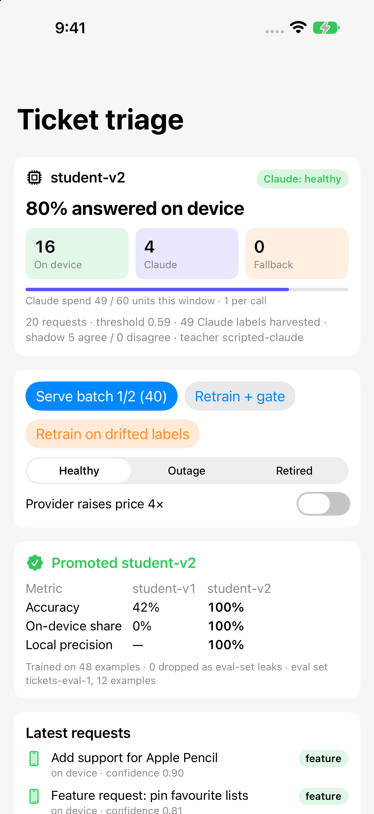
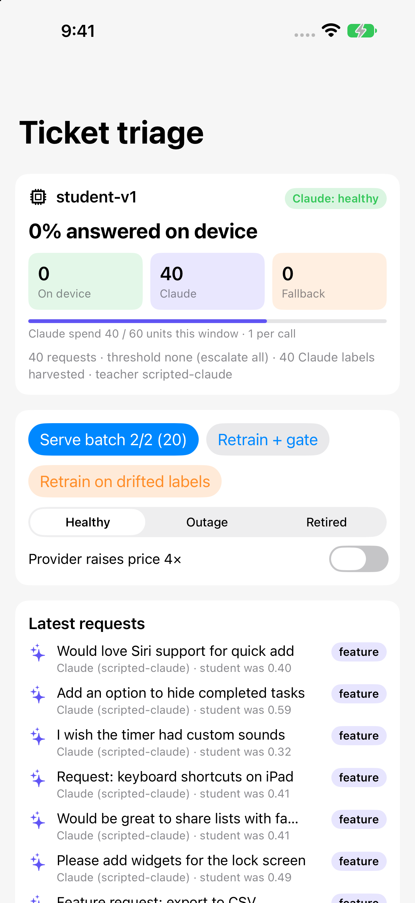
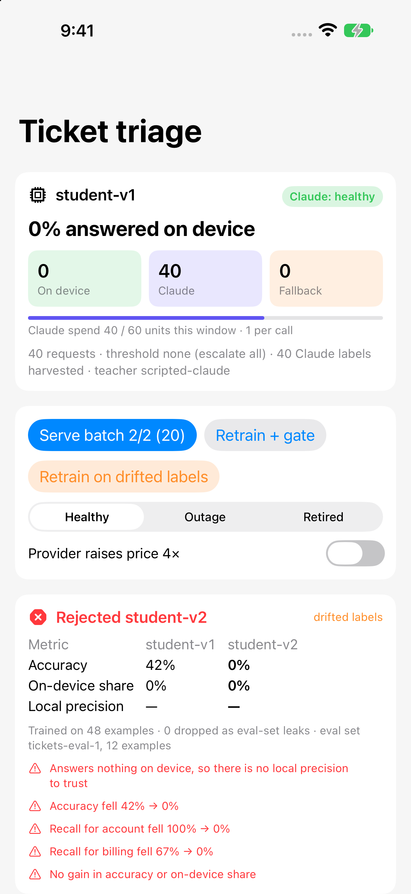
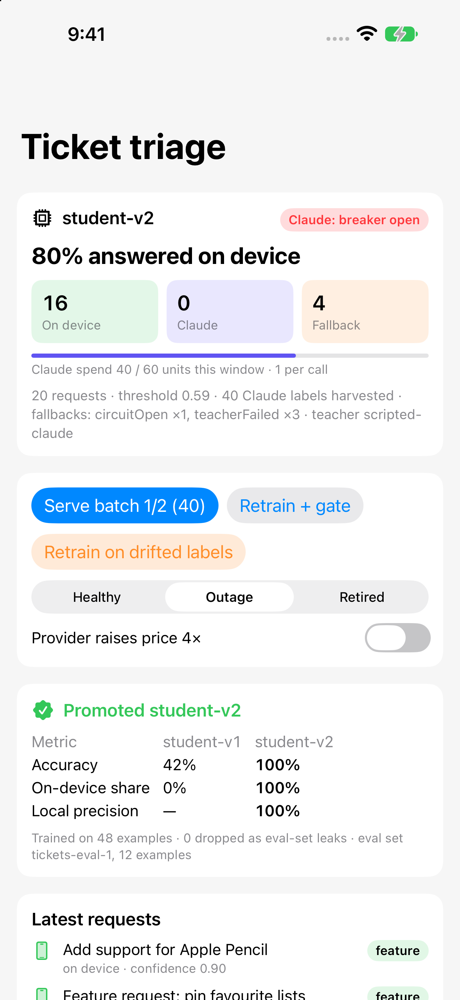

# HybridInference Demo

**Watch an on-device model take over from Claude, and watch a bad retrain get blocked.**

This iOS app runs the full teacher–student loop from
[HybridInference](https://github.com/rajatslakhina/hybrid-inference-router-kit) on a support-ticket triage
feature (billing / bug / account / feature):

1. **Day one.** Student v1 knows 8 hand-written examples and is not trusted with anything. Its calibrated
   threshold is "none", so all 40 tickets go to the teacher, and each answer is harvested as a label.
2. **Retrain and gate.** v2 is trained on seed + harvested labels, calibrated on a 12-ticket held-out eval set,
   and promoted only because it beats v1 on that eval set without losing ground on any label.
3. **Day two.** v2 serves 20 tickets it has never seen, and 16 of them (80%) stay on device.
4. **Things go wrong on purpose.** A retrain on drifted teacher labels is rejected. In an outage the breaker
   opens and the student carries the load. A retired model is replaced by a successor. A 4× price rise makes
   the budget run out sooner.

  

| Day one: v1 escalates everything | Drifted labels: the gate says no | Outage: breaker open, student serves |
| --- | --- | --- |
|  |  |  |

## Why this matters

A frontier-model call on every request means paying in latency, cost, availability and vendor risk on every
request. Moving the steady state on device only works if three things hold. The device model is trusted only
where it has earned it. The escalation path survives an outage, a price change or a retired model. And no
retrain ships unless it is better per label, not just on average. This app shows each of those in a screen you
can tap through.

## What you're looking at

| Screen element | Library type | What it shows |
| --- | --- | --- |
| "student-v2 · 80% answered on device" | `HybridRouter.snapshot()` | Share of the last batch the student answered without escalating |
| On device / Claude / Fallback tiles | `RouterSnapshot` | Where each request was answered, and fallbacks with their reasons |
| Spend bar | `EscalationBudget` | Units spent in the current window, against the cap |
| "threshold 0.59" | `ThresholdCalibrator` | Lowest confidence that keeps ≥ 90% precision on the eval set for *this* model version |
| "shadow x agree / y disagree" | `drainShadowQueue` | A deterministic 20% sample of confident on-device answers, re-checked by the teacher off the critical path |
| Promoted / Rejected card | `PromotionGate` + `Evaluator` | Incumbent vs candidate on the same fingerprinted eval set, with every failed check |
| Healthy / Outage / Retired | `ScriptedTeacher` faults, `replaceTeacher` | Breaker behaviour; leaving "Retired" migrates to a successor model |

The teacher here is `ScriptedTeacher`, a keyword-rule stand-in for Claude, so the demo runs offline with no API
key. The library's `ClaudeTeacher` is a drop-in replacement for production.

## How to run it

1. `git clone https://github.com/rajatslakhina/hybrid-inference-router-demo-app.git`
2. Open `Demo.xcodeproj` in Xcode 16 or later. Xcode resolves `HybridInference` from GitHub: "up to next major"
   from `1.2.4`, recorded exactly in the committed `Package.resolved`.
3. Select the **Demo** scheme and an iOS 17+ Simulator, then Build & Run.
4. Tap **Serve batch**, **Retrain + gate**, **Retrain on drifted labels**, switch the teacher mode, or raise the
   price.
5. To open straight into a state, pass `-stage fresh|baseline|retrained|drifted|outage`: in Xcode via
   *Product › Scheme › Edit Scheme… › Run › Arguments*, or on a booted Simulator with
   `xcrun simctl launch booted com.rajatlakhina.HybridInferenceDemo -stage outage`. Without it the app opens
   at `baseline`.

## How it's built

- `Demo/DemoApp.swift` is the whole app. It owns the scenario: the dataset, the teacher's rules, a 60-unit
  budget, the breaker settings, a 0.9 precision target and the gate thresholds. It hands that scenario to the
  library's `HybridInferenceLabView`.
- `HybridInference` is a **remote** Swift package (`XCRemoteSwiftPackageReference`) pinned by version, never a
  local path. The library repo has no app target.
- `Scripts/check_scenario_sync.py` runs in CI and fails if this scenario drifts from the copy the library's
  `LabStageTests` assert, at the exact version in `Package.resolved`.

## Design decisions and trade-offs

1. **A scripted teacher instead of live Claude.** `ScriptedTeacher` keeps the demo offline, free and
   deterministic, and it can inject an outage or a retirement on demand. *Rejected:* calling Claude from the
   app, which needs an API key in the binary (never acceptable) or a proxy that a reviewer cannot run, and gives
   screenshots nobody can reproduce. The cost is that the 100% eval score is partly circular (see the limits).
2. **The scenario lives in the app, not the library.** The data, prices, budget and thresholds are product
   decisions, so the library ships no defaults that look like recommendations. *Rejected:* a built-in demo
   scenario in `HybridInferenceUI`. It would be easier to import, but it would make toy numbers look like
   guidance.
3. **A separate repo pinned to a released version.** Building against the published release proves the package
   resolves and works for a real consumer. *Rejected:* an example target inside the library (it would give the
   library an app target) and a local-path package (it never tests what users actually download).
4. **Launch stages plus library tests instead of UI tests.** `-stage` arguments put the app into each state for
   screenshots, and the library's `LabStageTests` assert the same states through the same `HybridInferenceLab`
   methods. *Rejected:* XCUITest. It would be slower and flakier, and it would only re-check numbers that
   `LabStageTests` already pin, without testing anything extra.

## Verification

What was actually done for this release:

- **Ran on an iOS Simulator.** A dedicated iPhone 16 Pro Max simulator (iOS 27.2) was created for the run.
  The app was built with `xcodebuild` against the package resolved from GitHub, then installed and launched with
  `xcrun simctl` once per stage (`baseline`, `retrained`, `drifted`, `outage`). The process was confirmed alive
  after each launch, and the four screenshots above were captured from those runs. The same four stages were
  run the same way earlier in development against library 1.0.1 through 1.2.3 (process confirmed alive each
  time); those screenshots were superseded by these. The simulator was deleted
  afterwards.
- **Not run on the Simulator:** the "Retired → successor" migration and the 4× price rise. Both are driven
  through the same `HybridInferenceLab` methods by the library's `LabStageTests`, which run in its CI with this
  app's exact scenario and also assert the numbers shown in the four screenshots.
- **CI** ([Actions](https://github.com/rajatslakhina/hybrid-inference-router-demo-app/actions)): one `macos-15`
  job checks that the scenario still matches the library's test copy, resolves the package from GitHub at
  exactly the version in the committed `Package.resolved` (`-onlyUsePackageVersionsFromResolvedFile`), and
  builds the app for
  `generic/platform=iOS Simulator`, with warnings treated as errors on the app target. CI builds the app; it
  does not launch it.
- The library's own tests, mutation check and CI are described in its
  [README](https://github.com/rajatslakhina/hybrid-inference-router-kit#verification).

## Honest limits

- The dataset is a toy: 8 seed examples, 12 eval examples, 40 + 20 traffic tickets. The 100% eval scores for v2
  say the mechanism works on this data, not that the model is good. They are also partly circular: the scripted
  teacher's keyword rules agree with every eval label, and v2 learned from that teacher. A real deployment needs
  an eval set labelled independently of the teacher.
- Serving batches cycle. After batch 2, batch 1 comes round again, and v2 has trained on those tickets, so only
  the first pass over batch 2 is an out-of-sample measurement.
- State is in memory. Relaunching resets the router, the budget and the harvest.
- No live Claude call is made. See the library's limits for what `ClaudeTeacher` has and has not been tested
  against.

## License

MIT. See [LICENSE](LICENSE).
